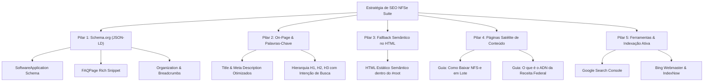
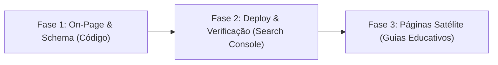

# Plano Estratégico de Otimização de SEO — NFSe Nacional Suite
**Domínio:** `https://nfsesuite.com.br/`  
**Objetivo:** Elevar o posicionamento orgânico no Google e Bing para buscas de contadores, escritórios fiscais, BPOs e empresas que necessitam automatizar o download e conferência de NFS-e no Portal Nacional.

---

## 1. Diagnóstico do Estado Atual

### Pontos Fortes Já Conquistados
- **Performance Técnica Excelente:** Servidor Vercel Edge em São Paulo (`gru1`) com TTFB de ~134ms, compressão Brotli e CDN global.
- **Segurança & Protocolo:** HTTPS nativo com HSTS ativo, domínio limpo e canônico configurado (`https://nfsesuite.com.br/`).
- **Arquivos Básicos Presentes:** `robots.txt` e `sitemap.xml` válidos e publicados.
- **Páginas Institucionais:** Páginas LGPD e Termos (`privacidade.html`, `termos.html`, `eula.html`) geram sinais de confiabilidade (E-E-A-T do Google).

### Gargalos e Oportunidades Críticas Identificadas
1. **Ausência de Dados Estruturados (Schema.org / JSON-LD):** O Google não possui marcação explícita de `SoftwareApplication`, `FAQPage` ou `Organization`. Com isso, o site perde a chance de exibir **Rich Snippets** (estrelas de avaliação, preço, perguntas frequentes em sanfona direto nos resultados de pesquisa).
2. **Dependência de Renderização Client-Side (React SPA):** O HTML entregue inicialmente pelo servidor é `<div id="root"></div>`. Embora o Googlebot processe JavaScript, ele coloca a renderização em uma fila secundária (*second-wave indexing*), o que atrasa ou reduz a indexação de trechos profundos. Robôs como Bingbot, Yahoo e rastreadores de redes sociais leem primariamente o HTML puro.
3. **Subaproveitamento de Palavras-Chave de Intenção Contábil (Cauda Longa):** Termos com alto volume de busca contábil no Brasil (como *"baixar XML NFSe Nacional em lote"*, *"danfse em lote portal nacional"*, *"robô coletor nfse receita federal"*) ainda têm baixa densidade semântica nos títulos e cabeçalhos.
4. **Falta de Verificação nos Painéis de Webmasters:** O site ainda não está vinculado ao Google Search Console e Bing Webmaster Tools com meta tags de verificação.

---

## 2. Pilares de Otimização Propostos



---

### Pilar 1: Dados Estruturados Schema.org (JSON-LD)
A inclusão de scripts JSON-LD no `<head>` do `index.html` fornece dados legíveis por máquina aos algoritmos do Google.

#### 1.1 `SoftwareApplication` / `WebApplication`
Informa que a página oferece um software para Windows e Web, com categoria, sistema operacional suportado e modelo de preços:
```json
{
  "@context": "https://schema.org",
  "@type": "SoftwareApplication",
  "name": "NFSe Nacional Suite",
  "operatingSystem": "Windows 10, Windows 11",
  "applicationCategory": "BusinessApplication",
  "offers": [
    {
      "@type": "Offer",
      "name": "Teste Grátis 15 Dias",
      "price": "0.00",
      "priceCurrency": "BRL"
    },
    {
      "@type": "Offer",
      "name": "Plano Pro Individual",
      "price": "49.00",
      "priceCurrency": "BRL",
      "priceSpecification": {
        "@type": "UnitPriceSpecification",
        "price": "49.00",
        "priceCurrency": "BRL",
        "unitText": "MONTH"
      }
    }
  ],
  "description": "Automatize a coleta em lote de NFS-e no Ambiente de Dados Nacional (ADN) com certificado digital A1/A3. PDFs DANFSe agrupados e planilhas Excel."
}
```

#### 1.2 `FAQPage` (Rich Snippet Sanfona no Google)
Permite que as dúvidas mais buscadas sobre certificados A1/A3, CAPTCHA e segurança apareçam diretamente na página de resultados de busca do Google com links para o site:
```json
{
  "@context": "https://schema.org",
  "@type": "FAQPage",
  "mainEntity": [
    {
      "@type": "Question",
      "name": "O aplicativo funciona com Certificado Digital A1 e A3?",
      "acceptedAnswer": {
        "@type": "Answer",
        "text": "Sim. Tanto o aplicativo Desktop quanto a extensão NFSe-Bridge acessam o repositório de certificados do Windows, sendo compatíveis com certificados A1 (.pfx) e certificados A3 (token ou cartão físico)."
      }
    },
    {
      "@type": "Question",
      "name": "Como baixar NFS-e em lote no Portal Nacional sem digitar CAPTCHA?",
      "acceptedAnswer": {
        "@type": "Answer",
        "text": "O NFSe Nacional Suite conecta-se diretamente à API oficial do Ambiente de Dados Nacional (ADN - NT 008/2026) via mTLS com o certificado da empresa, permitindo a coleta massiva sem necessidade de CAPTCHA manual."
      }
    }
  ]
}
```

#### 1.3 `Organization`
Identifica a marca `NFSe Nacional Suite`, URL oficial e logotipo, auxiliando na formação do painel de conhecimento do Google (*Google Knowledge Panel*).

---

### Pilar 2: SEO On-Page & Refinamento de Palavras-Chave

#### 2.1 Análise de Termos de Busca Contábeis (Search Intent)
Identificamos os principais termos que profissionais do setor fiscal e contábil digitam no Google:
| Termo de Busca (Keyword) | Intenção | Onde Inserir no Site |
| :--- | :--- | :--- |
| **"baixar nfse em lote portal nacional"** | Alta intenção de compra/uso | `<title>`, `<h1>` e Hero |
| **"coletar xml nfse nacional adn"** | Técnica / Solução de problema | `<h2>`, descrição dos entregáveis |
| **"danfse em lote pdf"** | Necessidade operacional | Seção de Entregáveis e FAQ |
| **"robo coletor nfse receita federal"** | Automação contábil | Seção Como Funciona e Comparativo |
| **"exportar nfse para excel"** | Relatório gerencial | Seção de Recursos e FAQ |
| **"consultar nfse certificado a1 a3"** | Compatibilidade de hardware | Seção de Segurança e FAQ |

#### 2.2 Otimização do `<title>` e `<meta description>`
- **Atual `<title>`:**  
  `NFSe Nacional Suite — Coleta em Lote e Gestão de NFS-e`
- **Novo `<title>` Recomendado:**  
  `NFSe Nacional Suite — Baixar NFS-e em Lote no Portal Nacional (XML & DANFSe)`  
  *(Contém os 3 termos mais buscados: "Baixar NFS-e em Lote", "Portal Nacional", "XML & DANFSe")*

- **Atual `<meta name="description">`:**  
  `Automatize a coleta em lote de NFS-e no Ambiente de Dados Nacional (ADN) com certificado digital A1/A3. PDFs DANFSe agrupados e planilhas Excel.`
- **Novo `<meta name="description">` Recomendado:**  
  `Baixe NFS-e em lote no Portal Nacional da Receita Federal (ADN) com Certificado A1 ou A3. Gere DANFSe em PDF único, planilhas Excel e organize XMLs. Teste 15 dias grátis.`

#### 2.3 Refinamento Semântico do `<h1>` e `<h2>`
- No Hero, manter a força comercial visual, mas garantir que a tag `<h1>` contenha o termo exato:  
  **`<h1>Baixar NFS-e em Lote no Portal Nacional: Coleta Automática de XML e DANFSe</h1>`**  
  (O subtítulo estilizado continua sendo exibido perfeitamente aos usuários).

---

### Pilar 3: Fallback Semântico no HTML Inicial (Instant Crawling)

#### O Problema das SPAs
O arquivo `index.html` atual possui:
```html
<div id="root"></div>
<script type="module" src="/src/main.tsx"></script>
```
Rastreadores que não executam JavaScript imediatamente enxergam uma página em branco.

#### A Solução
Injetar dentro de `<div id="root">` um bloco HTML estático estruturado com cabeçalhos (`<h1>`, `<h2>`, parágrafos-chave e links internos).
Quando o React carrega no navegador do usuário, o método `root.render(...)` do React 18 substitui instantaneamente esse fallback pela interface interativa, sem qualquer piscada visual.
**Benefício:** Rastreamento imediato na primeira onda de indexação do Googlebot, Bingbot e crawlers do LinkedIn/Twitter/WhatsApp.

---

### Pilar 4: Criação de Páginas Satélites Educativas (Tráfego de Topo de Funil)

Criar páginas HTML estáticas dedicadas a responder dores específicas que os contadores pesquisam no Google:
1. `https://nfsesuite.com.br/como-baixar-nfse-em-lote.html`:
   - Título: *"Como Baixar NFS-e em Lote no Portal Nacional da Receita Federal: Passo a Passo"*
   - Explica as limitações do portal web tradicional (um por um, CAPTCHA) e apresenta a automação via API com o NFSe Nacional Suite.
2. `https://nfsesuite.com.br/ambiente-dados-nacional-adn.html`:
   - Título: *"O que é o ADN (Ambiente de Dados Nacional) da NFS-e e como consultar via API"*
   - Atrai desenvolvedores, analistas fiscais e contadores que pesquisam termos da NT 008/2026.

Essas páginas recebem links no rodapé do site principal e geram tráfego orgânico qualificado e contínuo.

---

### Pilar 5: Ferramentas de Webmaster & Indexação Ativa

1. **Google Search Console:**
   - Adicionar a meta tag de verificação no `<head>` (`<meta name="google-site-verification" content="..." />`).
   - Submeter formalmente a URL do sitemap: `https://nfsesuite.com.br/sitemap.xml`.
   - Solicitar a indexação prioritária da página inicial e páginas LGPD/Termos.
2. **Bing Webmaster Tools & IndexNow:**
   - Cadastrar o site no Bing Webmaster Tools.
   - Ativar o protocolo **IndexNow**, que avisa instantaneamente o Bing e outros motores a cada deploy ou atualização do site.
3. **Sitemap Enriquecido com Imagens:**
   - Incluir marcações de `<image:image>` no `sitemap.xml` para indexação das capturas de tela e mockups da ferramenta na aba Imagens do Google.

---

### Pilar 6: SEO Off-Page & Autoridade de Domínio

1. **Chrome Web Store:**
   - Quando a extensão for publicada, ela terá um link oficial `do-follow` apontando para `https://nfsesuite.com.br/`. O domínio `chromewebstore.google.com` tem autoridade 95+ e transfere relevância imediata para o domínio da suíte.
2. **Comunidades e Portais Contábeis:**
   - Divulgação técnica em tópicos de dúvidas sobre o Portal Nacional nos portais Contábeis.com.br, Fórum Contábeis e grupos fiscais do LinkedIn.
3. **Repositório GitHub:**
   - O repositório público com Releases e README aponta diretamente para o domínio principal.

---

## 3. Roteiro de Implementação Sugerido



| Fase | Ações Principais | Impacto Esperado |
| :--- | :--- | :--- |
| **Fase 1 (Imediata)** | Inserir Schema JSON-LD (`SoftwareApplication`, `FAQPage`, `Organization`), otimizar `<title>`, `<meta description>`, enriquecer `<h1>`/`<h2>` e adicionar fallback semântico dentro de `#root`. | **Alto:** O Google passa a entender a estrutura, produtos e perguntas com rich snippets. |
| **Fase 2 (Configuração)** | Inserir tag do Search Console, submeter sitemap no Google e Bing, ativar IndexNow. | **Alto:** Acelera o tempo de rastreamento de semanas para dias/horas. |
| **Fase 3 (Expansão)** | Publicar o guia estático *"Como Baixar NFS-e em Lote"* com link cruzado para a landing page. | **Médio/Longo Prazo:** Captação de buscas orgânicas de contadores no topo do funil. |

---

## 4. Próximos Passos

Para iniciar a execução:
- **Opção A (Recomendada):** Executar a **Fase 1** (inserir todos os Schemas JSON-LD, atualizar `<title>`, `<meta description>`, palavras-chave semânticas e o fallback pré-renderizado no `index.html` e `App.tsx`).
- **Opção B:** Executar a Fase 1 e criar também o primeiro Guia Satélite (`como-baixar-nfse-em-lote.html`) para indexar junto com o sitemap.
